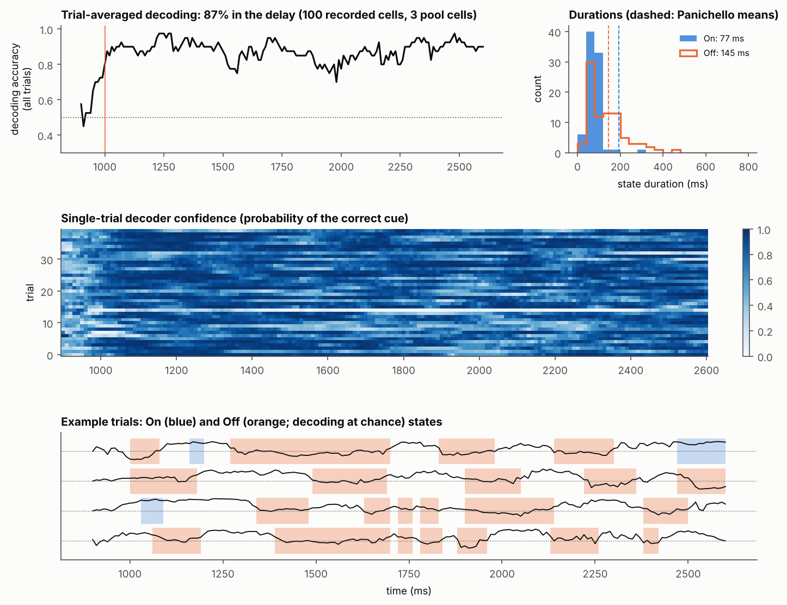
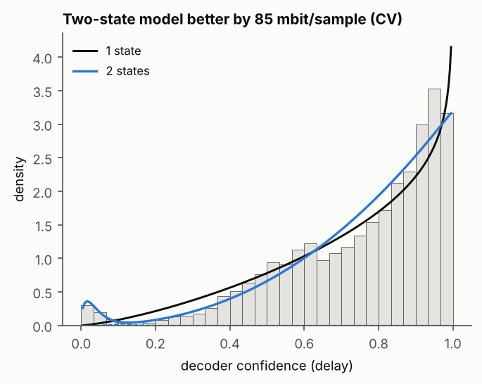
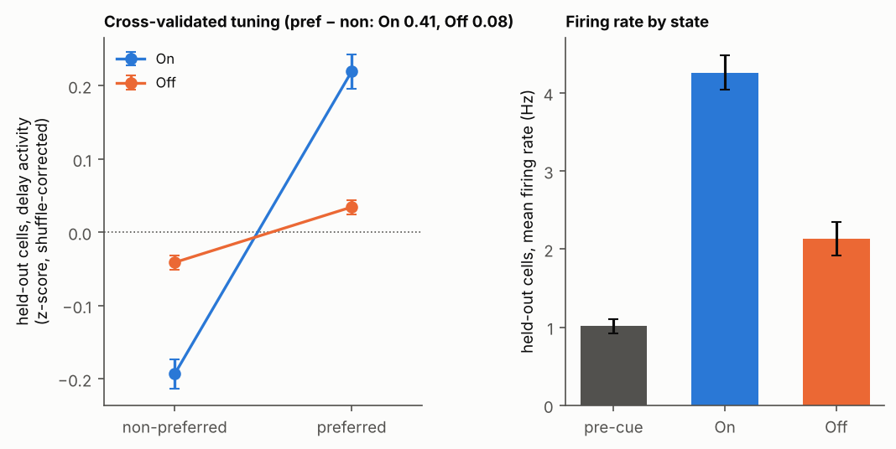
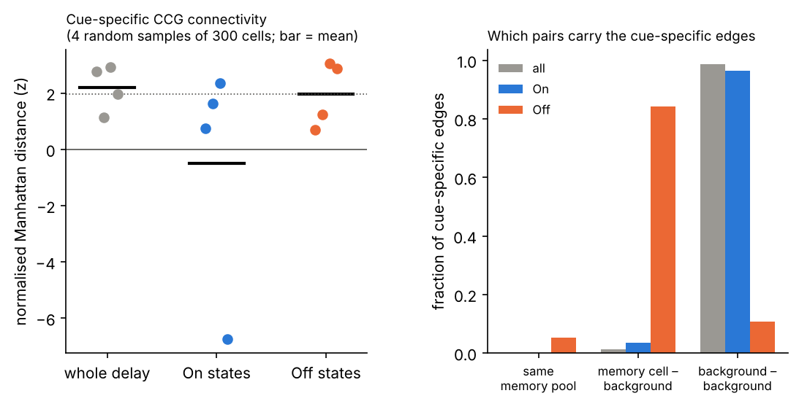
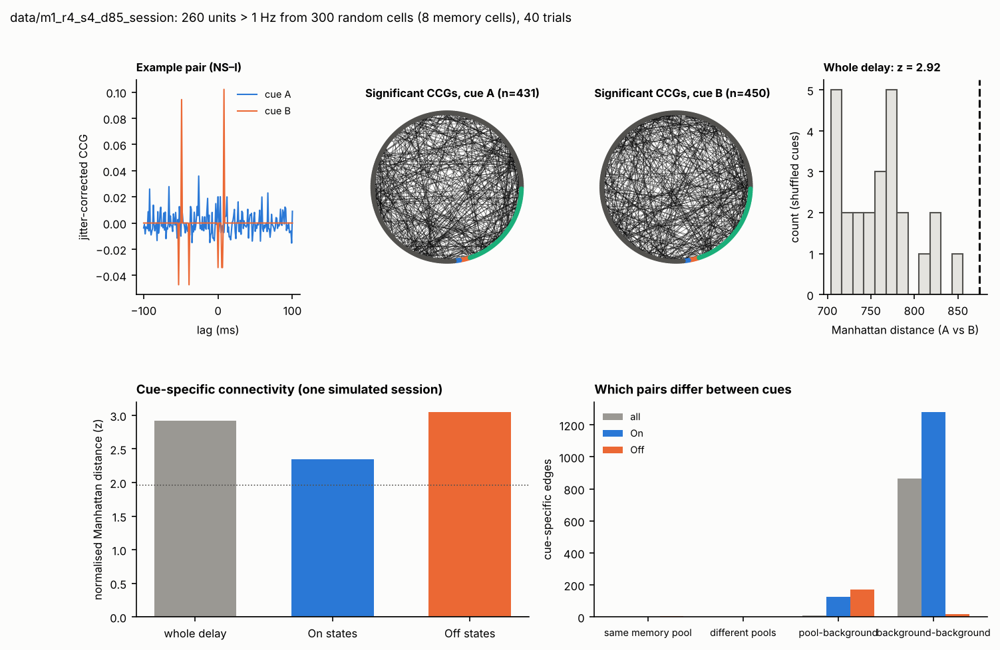
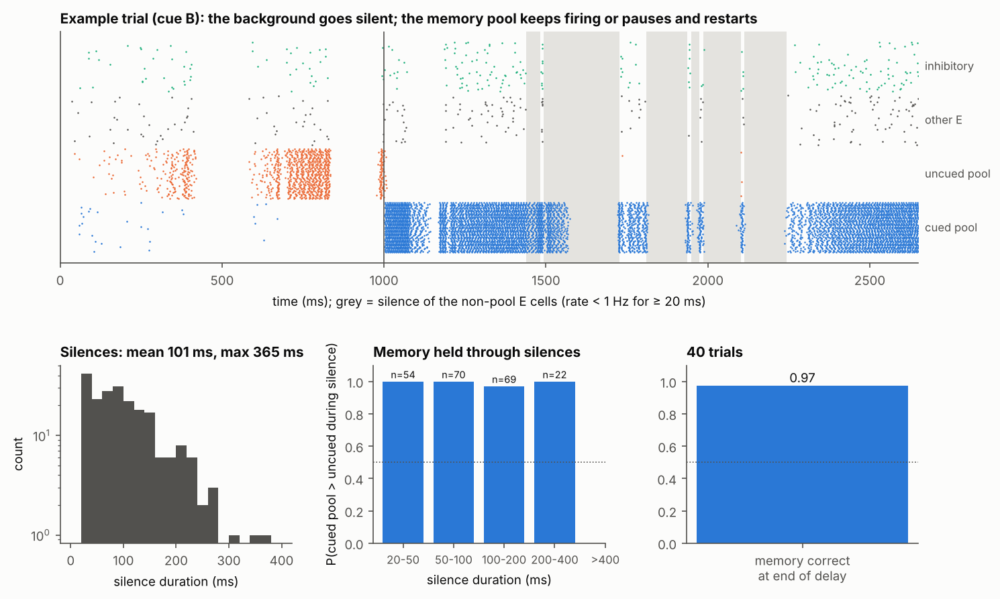

# How the model relates to Panichello et al. 2024 (Nature)

## The paper's argument
Panichello et al. recorded large prefrontal populations with Neuropixels during spatial working
memory and made four observations.

1. **Fig. 3:** on single trials, decoding of the remembered cue is intermittent.
2. **Fig. 4a–c, Extended Data Fig. 5:** the decoder alternates between On states (cue decodable)
   and Off states (decoding at chance), and a two-state model fits better than a one-state model.
3. **Fig. 4d,e:** during Off states, cue tuning of held-out neurons is almost gone and population
   firing rates fall.
4. **Fig. 5:** cue-specific functional connectivity, measured with CCGs, is present over the whole
   delay and during Off states, but not during On states.

From this they conclude that persistent activity is not sufficient for working memory. In their
view the memory is carried, at least during Off states, by cue-specific synaptic changes
(short-term plasticity), which is the "activity-silent" account.

## Our model
The model is a spiking network with fixed synapses, so no plasticity:
- **Size:** 12,500 LIF neurons in a Brunel-type sparse excitatory–inhibitory network.
- **Memory:** two small attractor pools (2% of excitatory cells each) with strong within-pool
  weights (α = 3.0). The cued pool fires persistently.
- **NMDA:** standard decay time of 100 ms.
- **Input dips:** brief shared dips in external drive, about 4 per second, about 90 ms long, drive
  cut by 85%. These could be read as spontaneous network-wide inhibitory events, such as beta
  bursts.
- **Task:** binary cue (A or B), 1.5 s delay, 40 trials.
- **Analysis:** Panichello's pipeline applied to uniform random samples of recorded cells: 100 cells
  for decoding, 300 cells for CCGs.

Model run: `data/m1_r4_s4_d85_session`. Figures: `figures/summaries/m1_r4_s4_d85/` and
`figures/ccg/`.

**Colour convention.** In the paper, On is orange and Off is blue. In our decoding figures, On is
blue and Off is orange.

## Paper figure by paper figure

| Paper | What they show | Model (no plasticity) | Match? |
|---|---|---|---|
| **Fig. 3** single-trial confidence | Intermittent decoding on single trials | Same: confidence drops to chance in bouts of ~100–300 ms, then recovers (fig. A) | yes |
| **Fig. 4b,c** On/Off counts and lengths | 2.4 On, 3.7 Off per trial; Off mean 146 ms, median 100 ms; On mean 192 ms | 2.0 On, 2.2 Off per trial; Off mean 145 ms, median 110 ms; On mean 77 ms (fig. A) | Off lengths yes; fewer Off states; On states shorter |
| **Extended Data Fig. 5** beta mixture | Two-state model beats one-state | Two-state better by +85 mbit/sample (fig. B) | yes |
| **Fig. 4d** held-out tuning | Strong in On, nearly gone in Off | pref − non 0.41 in On vs 0.08 in Off (fig. C, left) | yes |
| **Fig. 4e** population rate | Higher in On than Off | Held-out rate 4.3 Hz in On vs 2.1 Hz in Off (pre-cue 1.0 Hz) (fig. C, right) | yes |
| Trial-averaged decoding | ~70% | 87%, flat through the delay | too high |
| **Fig. 5** CCG connectivity | 1.36% significant pairs; cue-specific over the whole delay (P < 0.001) and in Off (P < 0.001), not in On (P = 0.13) | 1.3–1.5% significant pairs; cue-specific over the whole delay (z = 1.1–2.9) and in Off (z = 0.7–3.1) in all 4 samples; On inconsistent (fig. D) | qualitatively yes, but weaker and not independent sessions |
| Memory | Behaviour is accurate | Memory correct at end of delay in 39 of 40 trials; attractor stable | yes |

## What the model says about their interpretation
1. **Off states without plasticity.** Brief network-wide dips silence the whole network for about
   100–150 ms, memory pool included (fig. E). No spikes carry the cue, so any decoder fails, tuning
   vanishes and rates drop. These are the signatures in Figs. 3–4.
2. **The memory survives Off states through ordinary NMDA currents.** When the drive returns, the
   pool with residual NMDA activation (the cued one) restarts first. The cued pool leads during
   93–100% of background silences, and the memory is correct at the end in 39 of 40 trials.
   Fixed synapses and a standard 100 ms NMDA decay are enough. No facilitation is needed.
3. **Cue-specific CCG ensembles come from activity, not potentiated synapses.**
   - Over the whole delay, 98% of the cue-specific edges are between background cells that share
     input from the active memory pool. Which pool is active depends on the cue, so the pattern of
     CCG peaks does too.
   - In Off states, 85% of the cue-specific edges involve a memory cell. During many decoder Off
     states, the small memory pool is still firing or briefly restarting while the background is
     silent. A random sample contains too few memory cells to drive the decoder, but enough to
     leave cue-specific spike correlations.
   - So "cue-specific ensembles during Off states" (Fig. 5f) is also what a persistent-activity
     attractor predicts when it is subsampled.
4. **Subsampling is not required for the Off states themselves.** They persist when decoding from
   1,000 or 4,000 cells, from all 12,500, or from memory cells only, because they are real pauses of
   the whole network. Subsampling matters only for the CCG point above.

## Figures

**A. Decoding, single trials, state lengths** (paper Figs. 3, 4a–c)

**B. One- vs two-state beta mixture** (paper Extended Data Fig. 5)

**C. Held-out tuning and firing rate in On vs Off** (paper Fig. 4d,e)

**D. Cue-specific CCG connectivity** (paper Fig. 5): z-scores for 4 random 300-cell samples, and
which pairs carry the cue-specific edges.

Example session (CCG of one pair under the two cues, connectivity maps, shuffle null):

**E. Mechanism** (not in the paper): shared dips silence the background, and the memory pool keeps
firing or pauses and restarts.

## Open differences
- **Fewer Off states** (2.2 against 3.7 per trial) and **higher decoding** (87% against ~70%).
  Their delay length and trial structure should be matched before tuning further.
- **Shorter On states** (77 against 192 ms). In our data, high-confidence stretches are often not
  labelled On by the cluster-mass test, so part of this gap may come from the labelling procedure.
- **CCG statistics are weak and not independent.** There is one simulated session, 2 cues and 20
  trials per cue, while the paper has 25 sessions, 8 cues and about 52,000 pairs per session. A
  proper test needs several independently simulated sessions with more trials.
- **Binary cue instead of 8 locations.** Tuning curves are therefore two-point (preferred vs
  non-preferred).
