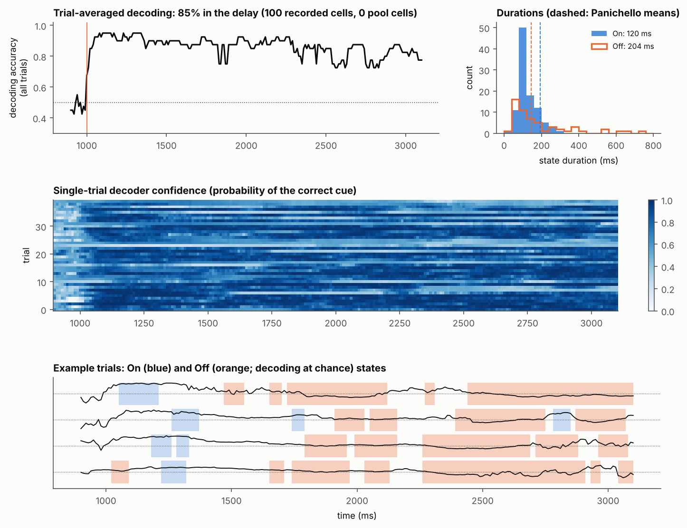
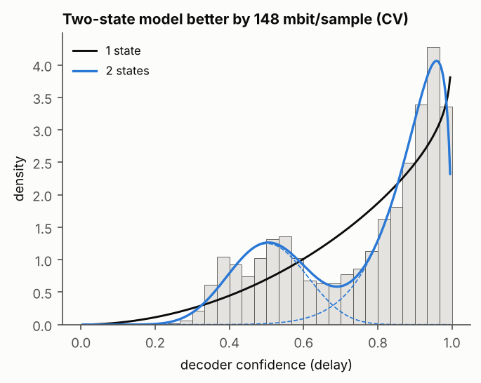
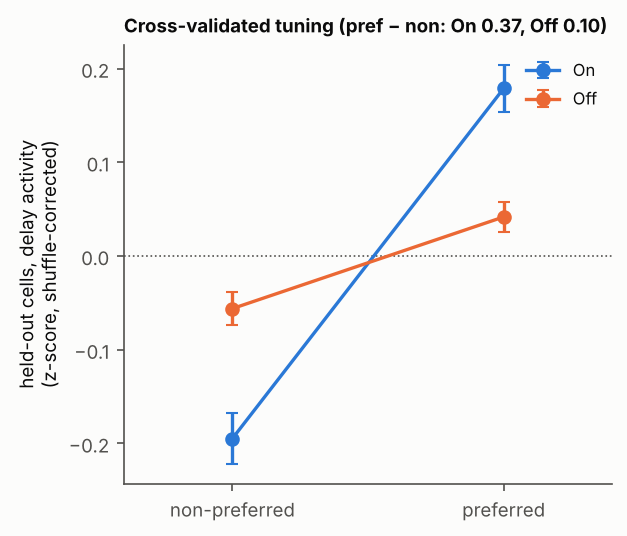

# Decoder Off states with a stationary memory and no synaptic plasticity: short report

**Model** (fixed weights throughout):
- **Network:** Brunel-style sparse E/I LIF network, 10,000 E and 2,500 I cells, g = 7,
  ν_ext = 0.9·ν_thr.
- **Synapses:** AMPA 2 ms, GABA_A 5 ms, NMDA 300 ms (40% of the excitatory charge).
- **Memory:** two pools, each 2% of the E cells. Within-pool weights are (2 + 2α)·J with α = 2.8;
  between-pool weights are 0. The cued pool fires ~90 Hz through the whole delay; the uncued pool
  fires ~0.4 Hz.
- **Source of the silences:** a slow fluctuation of the external drive, shared by all cells
  (Ornstein-Uhlenbeck, τ = 500 ms, SD = 45% of the drive, new on every trial). Nothing is
  timed or imposed. When the drive dips, the weakly driven background cells (all non-pool cells)
  fall silent. The memory pool holds the memory through the dip: it keeps firing, or pauses and
  restarts first thanks to NMDA.
- **Task:** binary, 40 trials, 2 s delay.
- **Recorded sample:** 100 random cells that are not in the memory pools (E and I).
- **Analysis:** Panichello's pipeline unchanged: 100 ms windows, leave-one-out logistic decoder,
  shuffled null, On/Off labelling, two-state beta-mixture test, split-half held-out tuning.

Figures: `figures/final_ouT_sd0.45_K100/`. Script: `scripts/final_figures.py --silence-pop NS --frac-selective 0`.
Data: `scripts/run_session.py` with `ext_noise_sd 0.45, ext_noise_tau 500` (see `summary.json` for every parameter).

| | Model | Panichello et al. 2024 |
|---|---|---|
| Memory over the delay | **stationary**: cued − uncued pool rate 81, 85, 90, 91 Hz in successive 500 ms bins; correct at end 97.5% (the 1 error is a cue that never started the memory) | – |
| Background silences | 1.8/s, mean 159 ms, 95th percentile 690 ms, max 1.7 s; 29% of the delay | – |
| Trial-averaged decoding (delay) | **85%**, flat across the delay | ~70% |
| Off states (decoding at chance) | 1.4 per trial, mean 204 ms (median 100) | 3.7 per trial, mean 146 ms (median 100) |
| On states | 2.5 per trial, mean 120 ms | 2.4 per trial, mean 192 ms |
| Two-state vs one-state beta model | **two states better, +148 mbit/sample** | two states better (19/25 sessions) |
| Held-out tuning, pref − non (On / Off) | **0.37 / 0.10** (3.7× lower in Off) | strongly reduced in Off |

## 1. Silences and the memory across them

During background silences, the cued pool is still firing 60% of the time. For the other 40%, both
pools are paused, and when firing restarts it is the cued pool that restarts (uncued pool ahead:
< 1%). In the example, the cued pool pauses from 2.6 to 3.1 s and then comes back.

## 2. Decoding: flat on average, clear Off states on single trials

## 3. Two-state (beta-mixture) test

## 4. Cross-validated tuning curves: tuning lost in Off states

With 200 recorded cells instead of 100:
- decoding is 85%;
- there is 1.0 Off state per trial, with a mean of 253 ms;
- the two-state test is better by +201 mbit/sample;
- held-out tuning is 0.47 in On vs 0.02 in Off (`figures/final_ouT_sd0.45_K200/`).

## 5. Is it an attractor? 60 s delays

Each trial below has a 60 s delay, 30 times the task delay. The model is the same as above.
- **No noise (left):** the cued pool sits on a flat ~125 Hz plateau for the full 60 s. The
  uncued pool stays silent. This is a true attractor: nothing decays and nothing drifts.
- **With the shared input noise (middle, right):** the active state is still an attractor. Between
  noise events, each pool returns to the same plateau. But a deep, long dip in the drive can switch
  both pools off for 1–10 s. After a short pause the cued pool restarts (NMDA). After a long one,
  either pool can restart. Over 60 s the memory flips to the wrong pool in:
  - 1 of 4 trials at SD 0.3;
  - 3 of 8 trials at SD 0.45 (the report model). The cued pool is ahead in ~85% of trials in the
    first seconds and in ~50–60% by 60 s.

  So with noise the memory is metastable, with a lifetime of tens of seconds. That is much longer
  than the 2 s task delay, which is why the 2 s statistics look stationary.

**Caveats.**
- The Off states are coordinated silences of the recorded (non-pool) cells. The memory itself
  sits in a small core of pool cells, about 4% of E, that are never in the sample. A recorded pool
  cell fires at ~90 Hz in On and in Off, so it would decode perfectly in both.
- The silences come from slow shared input noise, not from a purely internal mechanism.
- Decoding is 85%, not ~70%. Stronger noise (SD 55%) gives 77–79% and 1.8–1.9 Off states per
  trial (`figures/final_ouT_sd0.55_K*`). The cost is that ~10% of trials lose the memory during the
  delay, which shows as a dip in decoding late in the delay.
- The full history of attempts is in `REPORT.md`.
