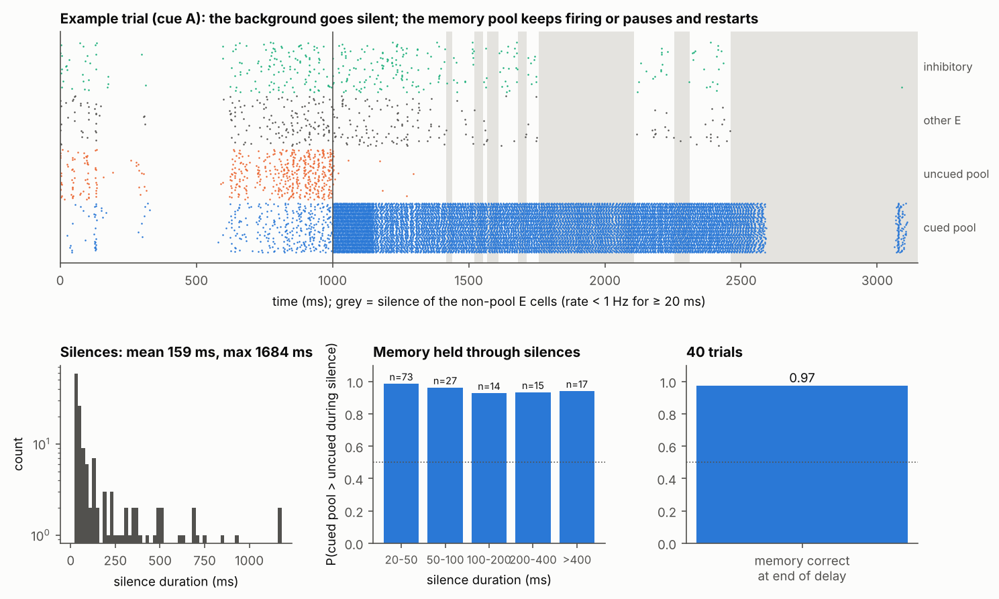
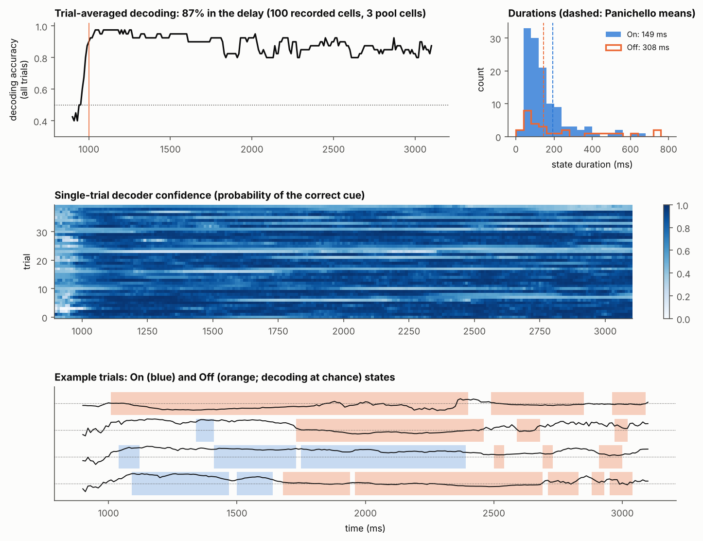
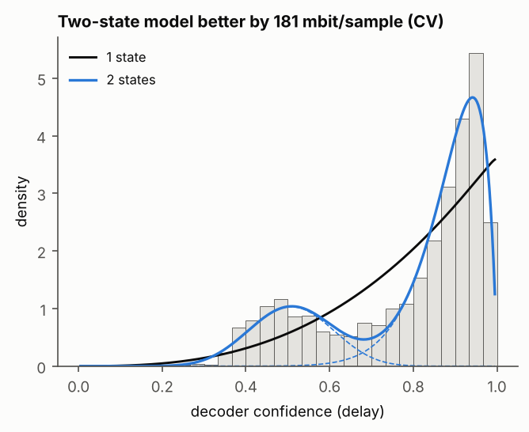
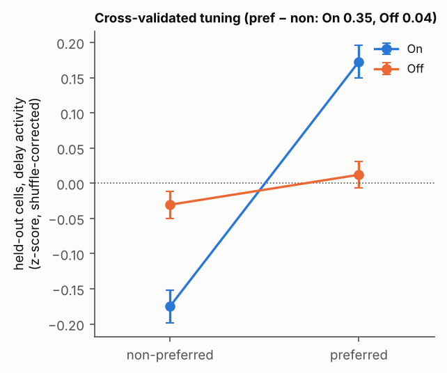
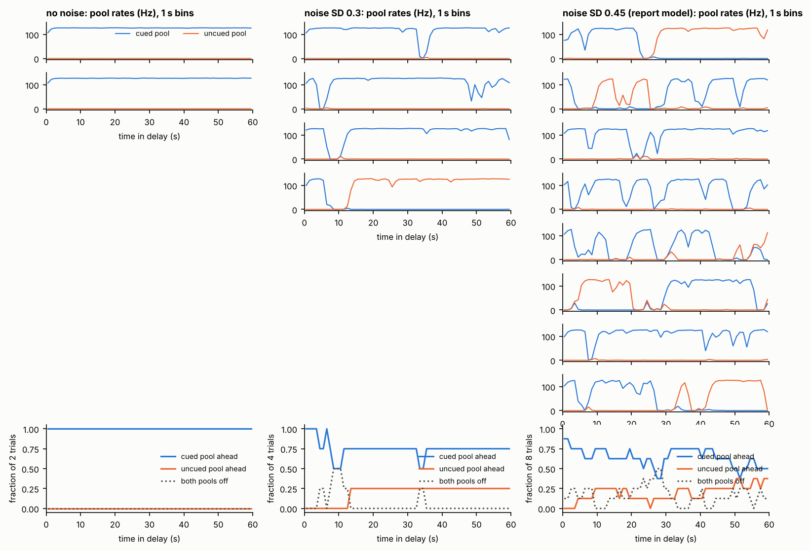
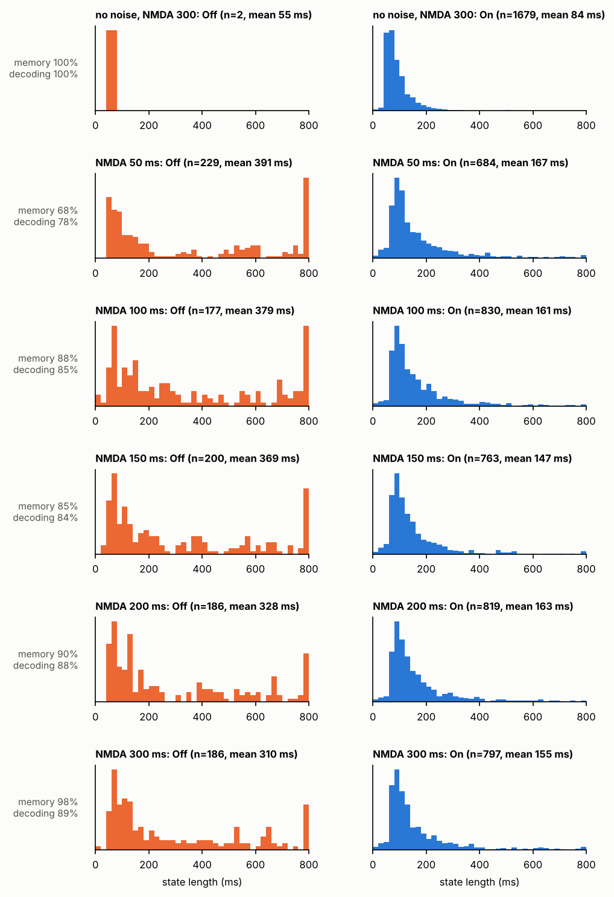

# Decoder Off states with a stationary memory and no synaptic plasticity: short report

**Model** (fixed weights throughout):
- **Network:** Brunel-style sparse E/I LIF network, 10,000 E and 2,500 I cells, g = 7,
  ν_ext = 0.9·ν_thr.
- **Synapses:** AMPA 2 ms, GABA_A 5 ms, NMDA 300 ms (40% of the excitatory charge).
- **Memory:** two pools, each 2% of the E cells. Within-pool weights are (2 + 2α)·J with α = 2.8;
  between-pool weights are 0. The cued pool fires ~90 Hz through the whole delay; the uncued pool
  fires ~0.4 Hz.
- **Source of the silences:** a slow fluctuation of the external drive, shared by all cells
  (Ornstein-Uhlenbeck, τ = 500 ms, SD = 45% of the drive, new on every trial). Nothing is
  timed or imposed. When the drive dips, the weakly driven background cells (all non-pool cells)
  fall silent. The memory pool holds the memory through the dip: it keeps firing, or pauses and
  restarts first thanks to NMDA.
- **Task:** binary, 40 trials, 2 s delay.
- **Recorded sample:** 100 cells drawn uniformly at random from the whole network, with no bias.
  In this draw, 3 of them are memory-pool cells.
- **Analysis:** Panichello's pipeline unchanged: 100 ms windows, leave-one-out logistic decoder,
  shuffled null, On/Off labelling, two-state beta-mixture test, split-half held-out tuning.

Figures: `figures/final_ouT_sd0.45_K100_random/`. Script: `scripts/final_figures.py --silence-pop NS` (uniform random sample).
Data: `scripts/run_session.py` with `ext_noise_sd 0.45, ext_noise_tau 500` (see `summary.json` for every parameter).

| | Model | Panichello et al. 2024 |
|---|---|---|
| Memory over the delay | **stationary**: cued − uncued pool rate 81, 85, 90, 91 Hz in successive 500 ms bins; correct at end 97.5% (the 1 error is a cue that never started the memory) | – |
| Background silences | 1.8/s, mean 159 ms, 95th percentile 690 ms, max 1.7 s; 29% of the delay | – |
| Trial-averaged decoding (delay) | **87%**, flat across the delay | ~70% |
| Off states (decoding at chance) | 0.8 per trial, mean 308 ms (median 150) | 3.7 per trial, mean 146 ms (median 100) |
| On states | 3.1 per trial, mean 149 ms | 2.4 per trial, mean 192 ms |
| Two-state vs one-state beta model | **two states better, +181 mbit/sample** | two states better (19/25 sessions) |
| Held-out tuning, pref − non (On / Off) | **0.35 / 0.04** (~9× lower in Off) | strongly reduced in Off |

## 1. Silences and the memory across them

During background silences, the cued pool is still firing 60% of the time. For the other 40%, both
pools are paused, and when firing restarts it is the cued pool that restarts (uncued pool ahead:
< 1%). In the example, the cued pool pauses from 2.6 to 3.1 s and then comes back.

## 2. Decoding: flat on average, clear Off states on single trials

## 3. Two-state (beta-mixture) test

## 4. Cross-validated tuning curves: tuning lost in Off states

**Other random draws.** The same result holds in 8 more independent random samples of 100 cells,
each with 2–4 pool cells (`figures/random_draws/`):
- decoding: 81–89%;
- Off states: 0.5–1.3 per trial, mean 195–400 ms;
- two-state test: better in every draw, by +58 to +247 mbit;
- held-out tuning: 0.32–0.45 in On vs 0.03–0.11 in Off.

The other draws cover noise SD 0.45 and SD 0.55. With 200 cells (1 pool cell), held-out tuning is
0.39 in On vs 0.05 in Off.

**Why random samples still show Off states.** The few sampled pool cells carry the memory whenever
the pool is firing. The decoder therefore fails mainly when the pool itself pauses: in the deepest
dips of the drive the whole network, memory pool included, falls silent for a few hundred ms. In
decoder-Off bins, the cued pool is ahead in only 38% of bins. In the rest both pools are silent,
and the memory exists only as decaying NMDA current in the cued pool's synapses, from which that
pool restarts. There is no plasticity: the trace is the ordinary NMDA time constant (300 ms).

**Subsampling is not needed.** The Off states survive with much larger random samples:

| Recorded cells (pool cells) | Decoding | Off per trial (mean) | Off fraction | Two-state gain | Held-out On / Off |
|---|---|---|---|---|---|
| 100 (3) | 87% | 0.8 (308 ms) | 20% | +181 mbit | 0.35 / 0.04 |
| 200 (1) | 87% | 0.95 (210 ms) | 20% | +212 mbit | 0.39 / 0.05 |
| 1,000 (29) | 89% | 0.7 (258 ms) | 16% | +471 mbit | 0.37 / −0.02 |
| 4,000 (133) | 90% | 0.6 (236 ms) | 14% | +712 mbit | 0.36 / −0.02 |

| 400 memory cells only | 92% | 0.47 (341 ms) | 15% | +1183 mbit | 1.62 / 0.02 |
| all 12,500 cells | 90% | Off states present, mean 253 ms | – | – | – |

The Off states are whole-network pauses, memory pool included, so no number of recorded cells can
decode through them. The memory then exists only as decaying NMDA current. Figures:
`figures/final_ouT_sd0.45_K{1000,4000}_random/`.

## 5. Is it an attractor? 60 s delays

Each trial below has a 60 s delay, 30 times the task delay. The model is the same as above.
- **No noise (left):** the cued pool sits on a flat ~125 Hz plateau for the full 60 s. The
  uncued pool stays silent. This is a true attractor: nothing decays and nothing drifts.
- **With the shared input noise (middle, right):** the active state is still an attractor. Between
  noise events, each pool returns to the same plateau. But a deep, long dip in the drive can switch
  both pools off for 1–10 s. After a short pause the cued pool restarts (NMDA). After a long one,
  either pool can restart. Over 60 s the memory flips to the wrong pool in:
  - 1 of 4 trials at SD 0.3;
  - 3 of 8 trials at SD 0.45 (the report model). The cued pool is ahead in ~85% of trials in the
    first seconds and in ~50–60% by 60 s.

  So with noise the memory is metastable, with a lifetime of tens of seconds. That is much longer
  than the 2 s task delay, which is why the 2 s statistics look stationary.

## 6. How slow must NMDA be? (sweep of the NMDA decay time)

Same network and noise, NMDA decay time 50–300 ms (same charge per spike), 40 trials each. State
lengths are pooled from 5 random samples of 100 cells.

| | No noise (300 ms) | 50 ms | 100 ms | 150 ms | 200 ms | 300 ms |
|---|---|---|---|---|---|---|
| Off states per trial | 0.01 | 1.15 | 0.89 | 1.0 | 0.93 | 0.93 |
| Cued pool restarts first after a pool pause | – | 46% | 53% | 64% | 67% | 93% |
| Memory correct at end of delay | 100% | 68% | 88% | 85% | 90% | 97% |

- **No noise means no Off states.** The shared input fluctuation is what causes them.
- **The shape of the On and Off histograms hardly depends on the NMDA decay time.** It is set by
  the noise.
- **The NMDA decay time sets whether the memory survives an Off state.** Below ~300 ms the cued
  pool restarts first only 46–67% of the time (13–15 pauses per model, so roughly ±13%), and
  Off states often erase the memory. A decay time of 300 ms is at the slow end of GluN2B values.

**Caveats.**
- With a random sample, Off states come mostly from pauses of the whole network, memory pool
  included. They do not come from the background alone. Long Off states (> ~300 ms) are therefore
  periods where the memory survives only in the NMDA trace.
- The silences come from slow shared input noise, not from a purely internal mechanism.
- Decoding is 85%, not ~70%. Stronger noise (SD 55%) gives 77–79% and 1.8–1.9 Off states per
  trial (`figures/final_ouT_sd0.55_K*`; random samples: 81–82%). The cost is that ~10% of trials lose the memory during the
  delay, which shows as a dip in decoding late in the delay.
- The full history of attempts is in `REPORT.md`.
