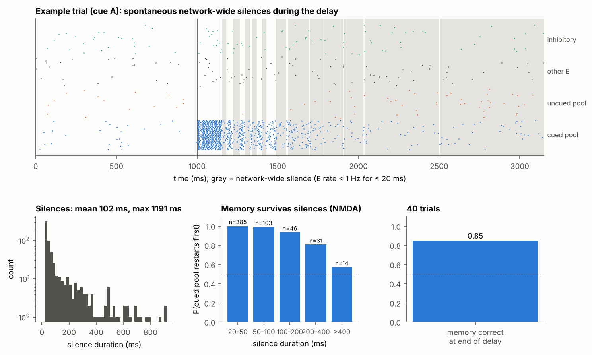
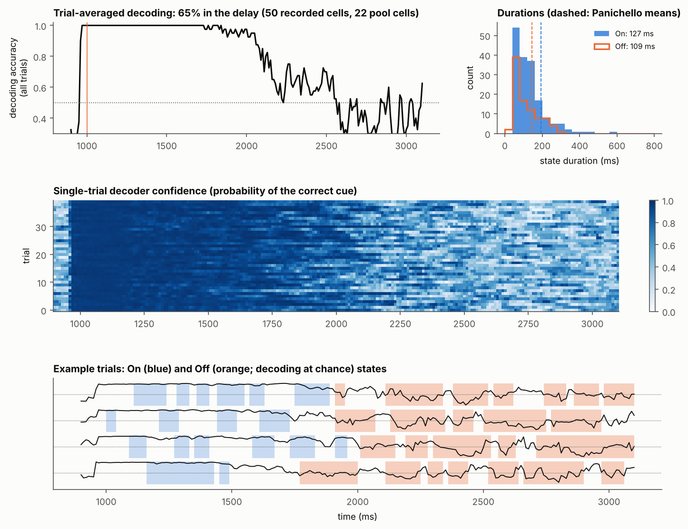
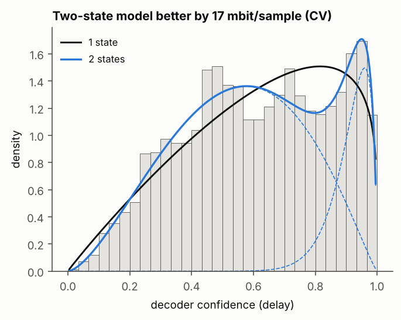
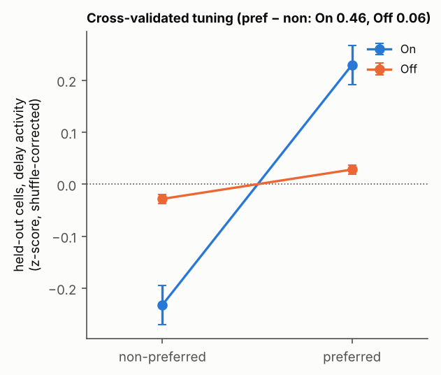

# Decoder Off states with no synaptic plasticity: short report

**Model:**
- **Network:** Brunel-style sparse E/I LIF network (10,000 E and 2,500 I cells; g = 7;
  ν_ext = 0.86·ν_thr) with fixed weights.
- **Memory:** two memory pools, each 2% of E cells, with strengthened within-pool synapses:
  α = 1.8, so within-pool weights are (2 + 2α)·J = 5.6·J and between-pool weights are 0.
  Pool cells get exactly equal input counts.
- **Synapses:** AMPA 2 ms, GABA 5 ms, NMDA 300 ms (40% of excitatory charge).
- **Task:** binary, 40 trials, 2 s delay.
- **Recorded sample:** 50 cells, 44% of them from the memory pools (as in Panichello).
- **Analysis:** Panichello's pipeline: 100 ms windows, leave-one-out logistic decoder,
  shuffled null, On/Off labelling, split-half held-out tuning.

Files: `figures/final_longA_K50_sel44/`. Script: `scripts/final_figures.py`.

| | Model | Panichello et al. 2024 |
|---|---|---|
| Spontaneous network-wide silences | 7.7/s, mean 102 ms, 95th percentile 467 ms, max 1.2 s | – |
| Trial-averaged decoding (delay) | **65%** | ~70% |
| Off states (decoding at chance) | 2.3 per trial, mean 109 ms (median 80) | 3.7 per trial, mean 146 ms (median 100) |
| On states | 4.3 per trial, mean 127 ms | 2.4 per trial, mean 192 ms |
| Two-state vs one-state beta model | +17 mbit/sample | two states better (19/25 sessions) |
| Held-out tuning, pref − non (On / Off) | **0.46 / 0.06** (8× lower in Off) | strongly reduced in Off |
| Memory still held by the network during Off | 81% of Off bins (correct at end of trial: 85%) | not measurable |

## 1. Long silences, and the memory survives them (NMDA)

## 2. Decoding: weak on average, clear Off states on single trials

## 3. Two-state (beta-mixture) test

## 4. Cross-validated tuning curves: tuning lost in Off states

**Caveat.** In this model, long silences and a stationary memory don't coexist. In the
plasticity-free settings tried, long silences only occurred where the memory slowly fades
over the delay: decoding is near 100% for the first ~1 s and close to chance after ~1.5 s
(fig. 2, top). So Off states are concentrated in the late delay rather than interleaved
throughout, and the 65% average mixes the two halves. Each silence is bridged almost
perfectly by NMDA (fig. 1), but there are many of them. Raising α to ≥ 1.98 gives a
stationary memory, but its silences are short (≤ 70 ms) and decoding never fails. The full
history of attempts is in `REPORT.md`.
